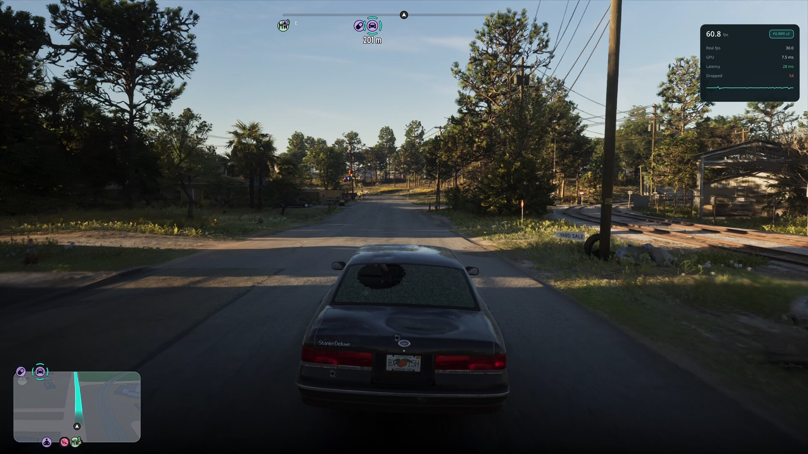
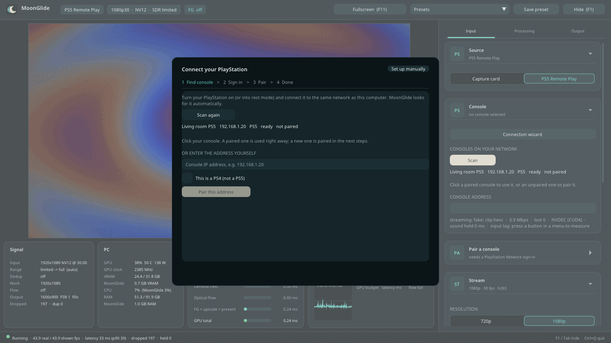
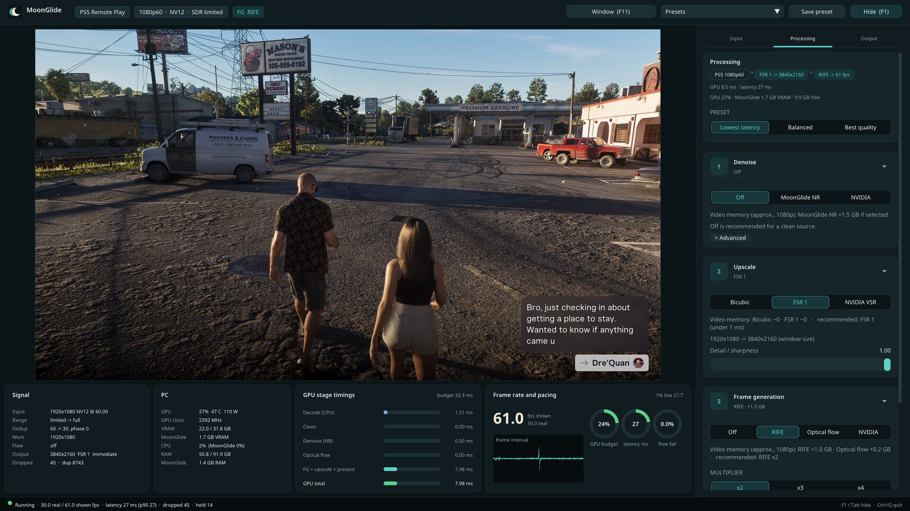

> 简体中文分支：见 [README.zh-CN.md](README.zh-CN.md)。

# MoonGlide

Makes **PS5 Remote Play** and **HDMI capture cards** look and feel better on Linux: upscaling to your screen and
frame generation (30 to 60 fps and up), on the GPU, in one fullscreen window.


<sub>Game footage: Grand Theft Auto VI, © Rockstar Games. Stream from a PS5 over Remote Play, RIFE x2, upscaled to 4K.</sub>

- **Frame generation**: RIFE on TensorRT, or a built-in optical-flow generator that needs nothing extra. x2, x3 or x4.
- **Upscaling**: FSR 1 with sharpening.
- **Neural denoise** (optional, RTX 40/50, bring your own model weights).
- **PS5 Remote Play** with a sign-in and pairing wizard and full DualSense support.
- **Capture cards** (V4L2), HUD/minimap exclusion zones, stats overlay.
- **MCP server** to read and tune a running instance ([docs/MCP.md](docs/MCP.md)).

## Requirements

- NVIDIA **RTX 20 series or newer** with the proprietary driver. The optional neural denoise needs RTX 40 or 50.
- X11 (Xorg or XWayland), x86-64, Ubuntu 24.04 or newer (or equivalent).

| Configuration (1080p source) | VRAM |
|---|---|
| Streaming only | ~0.65 GiB |
| **Default**: streaming + RIFE x2 | ~1.7 GiB |
| Streaming + neural denoise + RIFE | ~3.3 GiB |

## Install

1. Download `MoonGlide-x86_64.AppImage` from [Releases](../../releases).
2. `chmod +x MoonGlide-x86_64.AppImage && ./MoonGlide-x86_64.AppImage --ui`
   (without FUSE 2: add `--appimage-extract-and-run`).
3. For RIFE frame generation press **Install RIFE** in the app (Processing tab), or run
   `./MoonGlide-x86_64.AppImage setup-rife`. Other optional components: [docs/INSTALL.md](docs/INSTALL.md).

## Connect your PS5



1. On the PS5: **Settings > System > Remote Play > Enable Remote Play**. To wake it from rest mode also enable
   *Stay Connected to the Internet* and *Enable Turning On PS5 from Network*.
2. Start MoonGlide. The connection wizard opens on the first run (later: Input tab > *Connection wizard*).
3. Pick your console, sign in to PlayStation Network in the browser, then enter the PIN from
   *Settings > System > Remote Play > Pair Device*.
4. Press *Apply & restart*. Double-click the picture or press **F11** for fullscreen.

If the PS5 sits on "Who is using this PS5?", enable *Settings > Users and Accounts > Login Settings > Log In to PS5
Automatically*.

## Capture card

Pick **Capture card** in the Input tab (or `--source dongle --device /dev/videoN`). You need to be in the `video` group.

## Settings

**F1** or **Tab** opens the settings panel. Settings are saved to `~/.config/moonglide/config.toml`; all options are
in [docs/TUNING.md](docs/TUNING.md).



**Keys**: **N** denoise, **S** A/B split, **O** overlay (small, full, off), **H** HUD zones, **F1/Tab** settings, **F11** fullscreen,
**Ctrl+Q** quit.

## Docs

[INSTALL](docs/INSTALL.md) · [TUNING](docs/TUNING.md) · [ARCHITECTURE](docs/ARCHITECTURE.md) · [MCP](docs/MCP.md) ·
[WEIGHTS](docs/WEIGHTS.md)

## Build from source

Needs CMake, Ninja, GCC 13+, [glslang 16+](https://github.com/KhronosGroup/glslang/releases), `libx11-dev`,
`libjpeg-dev`, `libavcodec-dev`, `libavutil-dev`.

```sh
cmake -S . -B build -G Ninja -DGLSLANG=/path/to/glslang
ninja -C build
./build/moonglide --ui
```

The PS5 helper is built from [moonglide-chiaki-tap](https://github.com/lrfsh/moonglide-chiaki-tap). RIFE and other
optional backends: see [docs/INSTALL.md](docs/INSTALL.md).

## License

MIT ([LICENSE](LICENSE)). The PS5 helper `moonglide-chiaki-tap` is a separate AGPL-3.0 program (based on chiaki-ng).
Third-party licenses are in [NOTICE](NOTICE). Not affiliated with Sony or NVIDIA.

## Credits

[Veyra](https://github.com/Likely7/Veyra-NRVideo) by Likely7 (the Windows app that inspired MoonGlide) ·
[chiaki-ng](https://github.com/streetpea/chiaki-ng) · [Practical-RIFE](https://github.com/hzwer/Practical-RIFE) ·
[vs-rife](https://github.com/HolyWu/vs-rife) · [OpenDLSS-NR](https://github.com/maanHimself/OpenDLSS-NR) ·
[SmoovPlay](https://github.com/smoovplay/smoovplay) · AMD FidelityFX FSR 1 · [volk](https://github.com/zeux/volk) ·
[Dear ImGui](https://github.com/ocornut/imgui) · [lsfg-vk](https://github.com/PancakeTAS/lsfg-vk)
